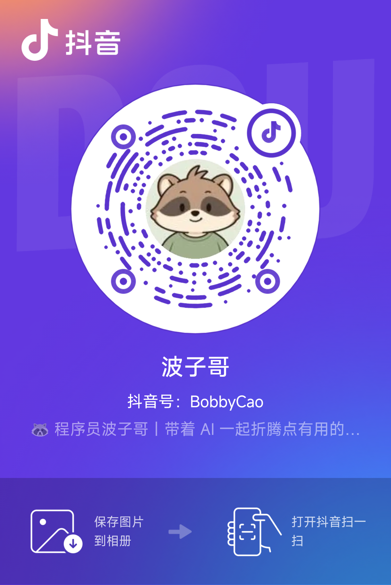
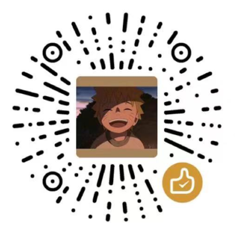

# Antigravity Boot

给 macOS 和 Windows 上的 Antigravity 和 Gemini 播放启动动画。

**下载 v1.1.0 · 五款动画版**　[GitHub Release](https://github.com/caofanqi/antigravity-boot/releases/tag/v1.1.0) · [Gitee 发行版](https://gitee.com/bobbycao/antigravity-boot/releases/tag/v1.1.0)

在发行页附件中选择 Mac 通用 DMG（Apple Silicon 和 Intel）或 Windows x64 便携 ZIP。

本版包含经典版、水彩绘本、霓虹都市、换班和 10 秒静音版「星门回眸」。两个平台都可以在启动前预览动画。此前的四款动画版仍可在 [GitHub Release](https://github.com/caofanqi/antigravity-boot/releases/tag/v1.0.0) 或 [Gitee 发行版](https://gitee.com/bobbycao/antigravity-boot/releases/tag/v1.0.0) 下载。

**macOS**　启动器在播放视频的同时打开目标应用。Antigravity 的窗口在片尾逐渐显现，Gemini 的动画向窗口中央收拢。点击「跳过」、按 Esc 或 ⌘.，可以提前进入应用。

## 波子哥 开源

开源不易，喜欢这个启动器的话，来抖音关注支持一下。**[抖音 · 波子哥（BobbyCao）](https://www.douyin.com/user/MS4wLjABAAAAqfTLdIWYEIvollbyqL6yeU2anTbgSXkD_2-N-FNuztk)**

<details>
<summary>查看抖音二维码</summary>



</details>

| 平台 | 主页 | 二维码名片 |
| --- | --- | --- |
| B 站 | [波子哥Bobby](https://b23.tv/X2NEjU0) | [查看二维码](docs/social/bilibili.png) |
| 小红书 | [波子哥 · 1140612912](https://www.xiaohongshu.com/user/profile/609b1a310000000001006e90) | [查看二维码](docs/social/xiaohongshu.jpg) |
| 快手 | [波子哥 · 2319178813](https://v.kuaishou.com/f/YgB4QAlJD) | [查看二维码](docs/social/kuaishou.jpg) |

### ☕ 请波子哥喝杯咖啡

开源不易，支持一杯咖啡，给牛马上上动力！

<details>
<summary>查看微信赞赏码</summary>



</details>

## Windows 便携版

适用于 Windows 10/11 x64，需要 .NET Framework 4.8 和系统媒体播放组件。

1. 下载 [Windows x64 便携包](downloads/Antigravity-Boot-Windows-x64.zip)（文件页点 Download 或「下载」）。完整解压 ZIP 到一个固定文件夹，双击里面的 **Antigravity Boot.exe**。也可以给这个 EXE 创建桌面快捷方式。
2. 选 **Gemini** 或 **Antigravity**，再选经典版、水彩绘本、霓虹都市、换班或星门回眸，点「启动」。启动器分别记住两个目标上次使用的动画。
3. Antigravity 使用本机客户端。若自动查找失败，在文件选择框里找到安装目录下的 `Antigravity.exe`。Gemini 优先使用可识别的 `Gemini.exe`，找不到时用 Microsoft Edge 打开独立的 Gemini 网页窗口。该窗口使用单独的浏览器资料，首次使用可能需要登录，后续会保留登录状态。
4. 动画末尾会对齐检测到的目标窗口并在约 1.25 秒内淡出。应用打开较慢时，动画会在片尾最多等待 10 秒；随时可按 **Esc** 或点「跳过」。仅打开这个启动器时播放动画。

**让 AI 帮我装到 Windows**，可以复制下面这句：

> 请帮我在这台 Windows 电脑安装 Antigravity Boot。仓库是 https://github.com/caofanqi/antigravity-boot ，备用地址是 https://gitee.com/bobbycao/antigravity-boot 。请从仓库的 downloads 目录下载 Windows x64 便携 ZIP，或使用我提供的 ZIP，完整解压后运行。装好后打开目标与动画选择窗口。

**从源码打包**，在安装了 .NET 8 SDK 的机器上，从仓库根目录执行以下命令。首次构建会从 NuGet 获取微软 .NET Framework 4.8 参考程序集。

```sh
dotnet restore Windows/AntigravityBoot.csproj
dotnet msbuild Windows/AntigravityBoot.csproj -t:PackageWindows -p:Configuration=Release
```

生成的便携包位于 `dist/Antigravity-Boot-Windows-x64.zip`。包内附有五段动画的使用说明。

## 让 AI 帮我安装到 Mac

在这台 Mac 上打开能操作本机终端的 AI 助手，把下面这句话完整发给它：

> 请帮我把 https://github.com/caofanqi/antigravity-boot 安装到这台 Mac，按 README 安装带「经典版、水彩绘本、霓虹都市、换班、星门回眸」五款动画的版本，装好后打开启动器。如果 GitHub 访问不了，请改用 https://gitee.com/bobbycao/antigravity-boot 。需要我登录或确认系统安装时告诉我。

**只发链接也可以。** 把 [GitHub 仓库](https://github.com/caofanqi/antigravity-boot) 或 [Gitee 仓库](https://gitee.com/bobbycao/antigravity-boot) 发给助手；如果它询问你想做什么，回复「帮我装到这台 Mac」。

### 给执行安装的 AI

1. 确认用户要安装到当前 Mac，系统为 macOS 13 或更高版本，并检查是否已安装 Antigravity 或 Gemini，至少需要其中一个。优先从本页顶部下载五款动画版 DMG，按下节安装。需要从源码构建时继续执行以下步骤。
2. 检查 Git 和 Swift 编译器（`git --version`、`xcrun --find swiftc`）。缺少开发工具时，运行 `xcode-select --install`，请用户完成系统安装窗口后继续。
3. 在新的临时目录中用 `git clone` 克隆用户所选的仓库，进入仓库根目录。若其中一个仓库网络不可达，可改用另一个镜像地址或使用已下载的五款动画版 DMG。
4. 执行下列命令构建、安装并打开五款动画版。默认装在当前用户的「应用程序」目录，无需管理员权限。若目标路径已有同名应用，先核对它是否为本项目，再和用户确认更新。

```sh
set -e
./build.sh demo
install_app="$HOME/Applications/Antigravity Boot.app"
mkdir -p "$HOME/Applications"
ditto "build/Antigravity Boot.app" "$install_app"
codesign --verify --strict --all-architectures "$install_app"
open "$install_app"
```

5. 确认启动器实际打开，告诉用户安装位置。首次打开可选目标应用和动画；已启用直接启动时，按住 Option 打开即可回到选择窗口。

## 安装和使用

1. 准备一台运行 macOS 13 或更高版本的 Mac，并安装 Antigravity 或 Gemini。安装包支持 Apple Silicon 和 Intel。
2. 打开 DMG，将 **Antigravity Boot** 拖到旁边的 **Applications**，然后从「应用程序」打开启动器。需要 Dock 入口时，将启动器拖入 Dock。
3. 选择目标应用和启动动画。公开标准版内置 4 秒「星轨」。选择「选择本地视频…」，再点击「启动」，即可使用自己的 MP4。推荐 H.264 视频。自选视频按原路径保存，请保留该文件。
4. 两个目标应用分别记住动画选择。勾选「以后直接启动选中的应用」可跳过选择窗口。按住 **Option** 打开启动器，直到选择窗口出现，即可更改。

Mac 安装包采用本地临时签名，尚未获 Apple 公证。从网上下载时，macOS 可能提示无法验证开发者。首次打开时可参阅 [Apple 的 Mac 应用安全说明](https://support.apple.com/zh-cn/102445)。

在 Mac 的选择窗口中，点「预览动画」可播放当前影片，点「返回设置」继续选择。勾选「从原 App 启动时播放动画」后，点「仅保存」或「启动」生效。Gemini 和 Antigravity 分别保存这个开关。完全退出所选 App 后，下次从 Dock、启动台或 Finder 打开它时会播放动画；切换到已运行的窗口不会触发。首次开启时，macOS 可能要求在系统设置的「登录项」中允许后台运行。关闭最后一个目标的开关并保存后，后台监听会注销。

## 从源码构建

在装有 Xcode Command Line Tools 的 Mac 上，解压源码并进入项目目录：

```sh
./build.sh public
open "build/public/Antigravity Boot.app"
```

构建使用系统 AppKit、AVFoundation 和 Core Image。脚本分别编译 arm64 和 x86_64，再合并成通用二进制。随包的星轨动画支持离线构建。

生成带「应用程序」拖放入口的 DMG：

```sh
./package.sh public
```

安装包输出至 `dist/`。分发前可使用 `shasum -a 256 -c SHA256SUMS.txt` 核对同目录的发布文件。

## 媒体与许可

代码、脚本、自制图标和原创星轨动画使用 [MIT 许可证](LICENSE)。星轨由几何轨道、光点和中心星组成。

录屏版内置经典版、水彩绘本、霓虹都市、换班和星门回眸五段角色动画。**这五段动画不开源，不适用 MIT 许可证，禁止商业使用。** 个人可用它们体验启动器或进行本项目的非商业演示。分享含动画的完整项目或安装包时，请保留[随附角色动画使用说明](Media/ANIMATION_NOTICE.md)。

从含有五段 MP4 的仓库检出后，运行 `./package.sh demo` 即可构建录屏版。

## 窗口交接

启动器读取 macOS 提供的可见窗口位置，让视频对齐目标窗口。宽高比不同时，用画面边缘的镜像填满空白。10 秒动画的末尾 2.25 秒用于交接；启动期间若目标窗口尚不可见，启动器会在居中位置淡出并尝试激活目标应用。
